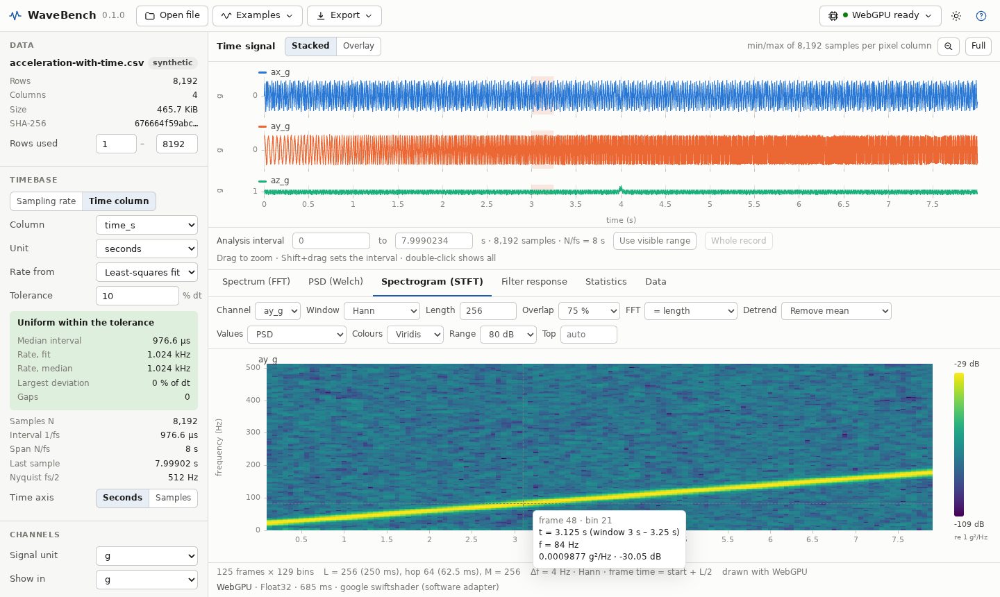
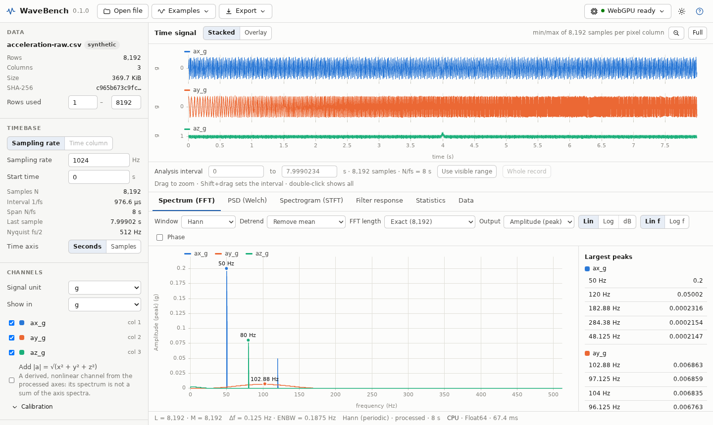
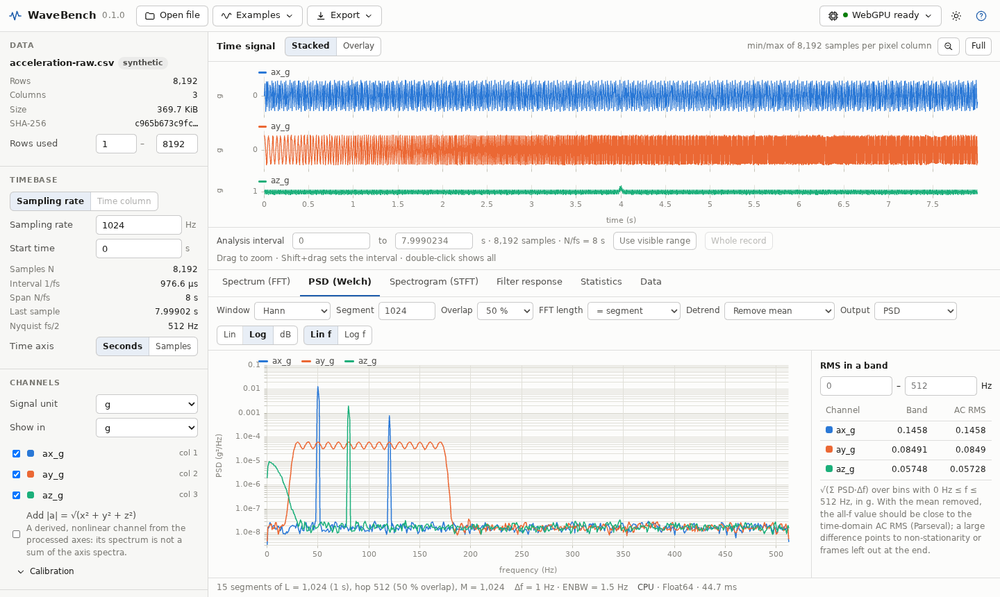
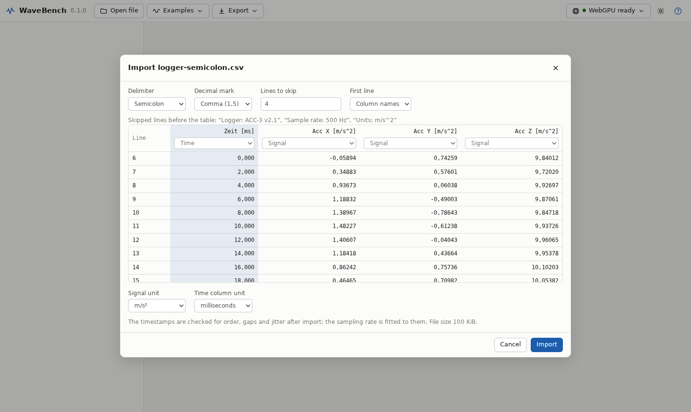
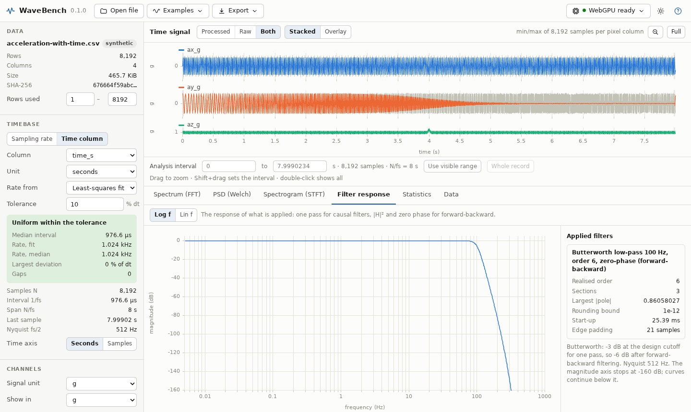
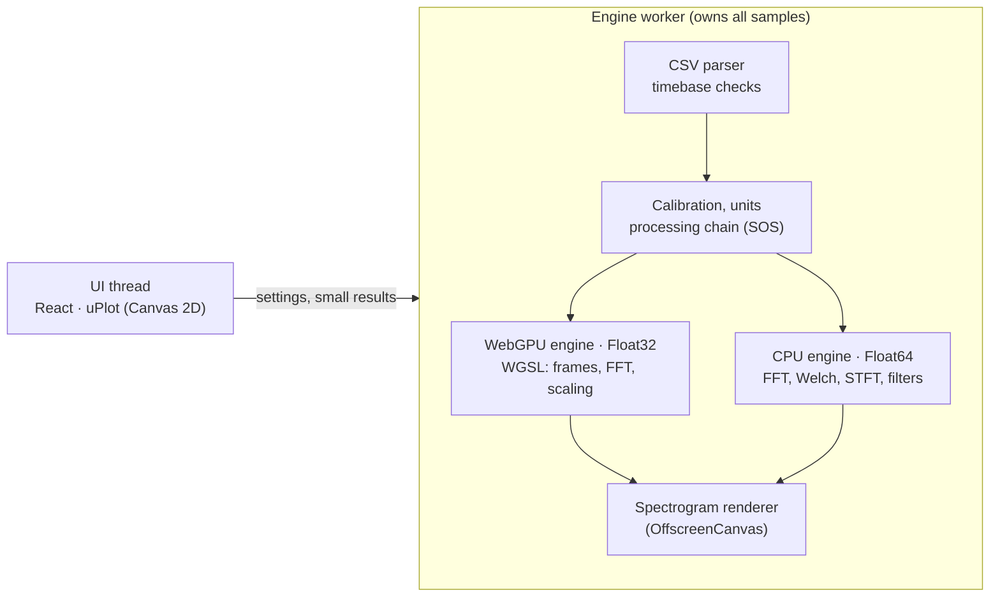

<h1 align="center">WaveBench</h1>

<p align="center">
  <b>Signal processing in the browser for raw sensor records – 3-axis accelerometer and vibration data.</b><br />
  Timebase checks, Butterworth and notch filters, FFT spectra, Welch PSD and STFT spectrograms,<br />
  computed with WebGPU and a Float64 reference engine that is checked against SciPy. Your data never leaves your computer.
</p>

<p align="center">
  <a href="https://kilickursat.github.io/WaveBench/"><b>Open the app</b></a> ·
  <a href="docs/USER_GUIDE.md">User guide</a> ·
  <a href="docs/DSP_SPEC.md">Numerical conventions</a> ·
  <a href="docs/VALIDATION.md">Validation</a> ·
  <a href="https://github.com/kilickursat/WaveBench/releases">Offline file</a>
</p>

<p align="center">
  <a href="https://github.com/kilickursat/WaveBench/actions/workflows/ci.yml"></a>
  <a href="https://kilickursat.github.io/WaveBench/"></a>
  <a href="LICENSE"></a>
  
  
  
</p>



## What it does

WaveBench is an open-source workbench for the everyday analysis of sampled signals, in the spirit of a desktop
analysis package but in a web page. Open a CSV, TSV or TXT file from an accelerometer logger, a data-acquisition
system or a simulation, and:

- **Set or check the timebase.** Enter the sampling rate, or let WaveBench check a time column (seconds, ms, µs, ns or
  ISO 8601 date-times) for order, gaps and jitter and fit the rate to it. Irregular records are refused for FFT work
  until you choose a gap-free range or an explicit rate – nothing is resampled, sorted or zero-filled behind your back.
- **Calibrate and convert units.** Offset and gain per channel; exact conversions between g, mg, m/s², mm/s² and Gal
  (1 g = 9.80665 m/s²). Counts and volts stay labelled as such until you calibrate them.
- **Filter.** Butterworth low-pass and high-pass (order up to 16), band-pass and band-stop (prototype order up to 10)
  and notch filters, as second-order sections, applied zero-phase (forward-backward) or causally. The response of what is actually applied
  is plotted, with its start-up transient marked on the time plot.
- **Analyse.** FFT amplitude (peak or RMS), power, PSD and ASD with five windows and exact lengths (no silent
  zero-padding); Welch PSD with band RMS beside the time-domain RMS; STFT spectrograms with linked cursors; statistics;
  the full data table.
- **Export.** CSV of every result, filter coefficients, a PNG figure, and a recipe (JSON) that records every setting,
  convention and the input file's SHA-256, so an analysis can be repeated.

| Spectrum with peak table | Welch PSD with band RMS |
| --- | --- |
|  |  |
| **Importing a logger file** | **A zero-phase low-pass filter and its response** |
|  |  |

## Why the numbers can be trusted

- **Every convention is written down and shown.** One-sided scaling, window corrections, PSD units, frame times and
  decibel references follow [docs/DSP_SPEC.md](docs/DSP_SPEC.md); each result states its window, lengths, Δf, ENBW,
  backend and precision.
- **Checked against independent references.** The Float64 CPU engine is compared with NumPy/SciPy fixtures (FFT of any
  length, windows, detrending, periodogram, Welch, STFT, Butterworth design and filtering, notch filters) and, for
  filters, with 50-digit references computed in mpmath – so a near-unstable design is judged against the truth, not
  against another Float64 program.
- **The GPU is checked against the CPU.** WebGPU kernels run in Float32 and are compared with the Float64 engine on
  every build, and you can run the same check on your own GPU from the app (*Compute → Check this GPU*).
- **It refuses rather than guesses.** Cutoffs at or above Nyquist, segments longer than the data, missing samples,
  irregular timestamps and filters too ill-conditioned for Float64 are rejected with an explanation.

Measured on this build (details and commands in [docs/VALIDATION.md](docs/VALIDATION.md)):

| Check | Reference | Gate | Result |
| --- | --- | --- | --- |
| CPU FFT (15 sizes, radix-2 and Bluestein), spectra, Welch, STFT | NumPy 2.3.5 / SciPy 1.17.0 | normalised L2 ≤ 1e-12 | pass |
| Windows, detrending, statistics | SciPy / NumPy | ≤ 1e-14 | pass |
| 22 Butterworth designs, 4 notches: coefficients, response, outputs | SciPy and 50-digit mpmath | max(1e-12, 1e-15/δ²), δ = 1 − max\|p\| | pass |
| WebGPU FFT 2…262,144 points, STFT, Welch | Float64 CPU engine | ≤ 1e-4 | max 1.6e-7 (SwiftShader) |
| WebGPU on SciPy fixtures through the app | SciPy | ≤ 1e-4 | 31/31 pass |

## Quick start

**Use it:** open <https://kilickursat.github.io/WaveBench/>, then *Examples* or drop a file on the page. For use without a
network, download `wavebench-offline.html` from the [releases](https://github.com/kilickursat/WaveBench/releases) (or the
live site) and open it from disk: it is the same single file.

**Develop:** Node.js 20.19 or newer.

```sh
npm ci
npm test            # unit tests (Vitest, Node): CPU engine against the reference fixtures
npm run build       # type-check and build dist/index.html (= dist/wavebench-offline.html)
npm run test:e2e    # browser checks of the build: GPU against CPU and SciPy, UI smoke test, no network
npm run dev         # development server
```

The browser checks need Playwright's Chromium (`npx playwright install chromium`). Regenerating the reference fixtures
needs Python with the pinned packages in `reference/requirements.txt` (`npm run fixtures`).

## Input files

Delimited text with one row per sample: comma, semicolon, tab, vertical bar or spaces; decimal point or decimal comma;
optional header and leading metadata lines; `#`, `%` or `//` comment lines. Columns are signals, a time column or
ignored. Without a time column you enter the sampling rate; with one, its timestamps are checked and kept.

```csv
time_s,ax_g,ay_g,az_g
0,-0.00067,0.12307,0.99821
0.0009765625,0.09388,0.11449,1.03575
```

The bundled examples in [examples/](examples/) are synthetic (8,192 samples at 1024 Hz: tones, a chirp, a pulse and a
1 g offset) and come with the recipe that analyses them.

## Numerical conventions in brief

| Quantity | Definition (one-sided, C = 1 at DC and at Nyquist for even M, else 2) | Unit |
| --- | --- | --- |
| Peak amplitude | C·\|X[k]\| / \|Σw\| | signal unit |
| RMS amplitude | peak / √2 (DC and Nyquist: peak) | signal unit |
| Power | C·\|X[k]\|² / (Σw)² | unit² |
| PSD | C·\|X[k]\|² / (fs·Σw²) | unit²/Hz |
| ASD | √PSD | unit/√Hz |
| Frame time | start + (p·H + L/2) / fs, complete frames only | s |

X[k] = Σ w[n]·u[n]·e^(−2πikn/M), f[k] = k·fs/M, periodic windows, u the detrended segment. Welch is the mean of the frame
PSDs. Full definitions: [docs/DSP_SPEC.md](docs/DSP_SPEC.md).

## How it works



- **packages/core** – timebase, units, CSV import, statistics, synthetic signals.
- **packages/dsp-cpu** – FFT (radix-2 and Bluestein), windows, detrending, spectra, Welch, STFT, Butterworth and notch
  design, SOS filtering, responses.
- **packages/dsp-webgpu** – WGSL kernels (framing with detrend, Stockham FFT, one-sided scaling, reductions), spectrogram
  rendering, the GPU self-test.
- **packages/plots** – colour maps, heatmap mapping, display decimation.
- **apps/web** – the application.

By default (*Auto*) spectrograms run on WebGPU when it is available; spectra and PSD run on the CPU in Float64. Without
WebGPU everything runs on the CPU. Plots of long records show a min/max envelope per pixel column; analyses always use
every sample.

## Browser support

Any current desktop or mobile browser runs WaveBench on the CPU. WebGPU is used where the browser offers it (current
Chrome and Edge, Safari 26, Firefox on some platforms); otherwise WaveBench says so and computes on the CPU. The GPU kernels
are validated on a software adapter (SwiftShader) in CI; run *Check this GPU* in the app to validate your hardware.

## Roadmap

Resampling and decimation with anti-alias filtering, cross-spectra, coherence and transfer functions, integration to
velocity and displacement with drift control, envelope and order analysis, more import formats, and vector figure
export. See [docs/ROADMAP.md](docs/ROADMAP.md).

## Contributing

Bug reports, test files and pull requests are welcome – please read [CONTRIBUTING.md](CONTRIBUTING.md). Numerical changes
come with a reference test.

## Citation

If WaveBench helps your work, please cite it using [CITATION.cff](CITATION.cff) (GitHub: *Cite this repository*).

## License

[Apache License 2.0](LICENSE). Third-party notices: [NOTICE](NOTICE).
